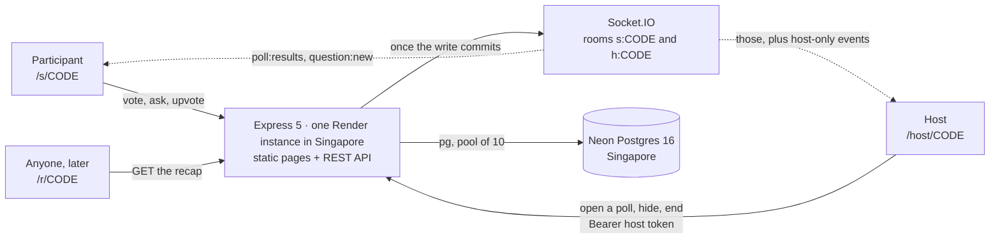
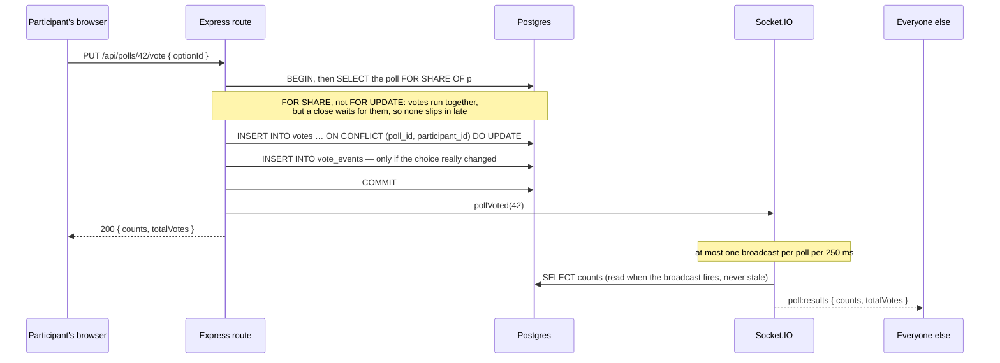
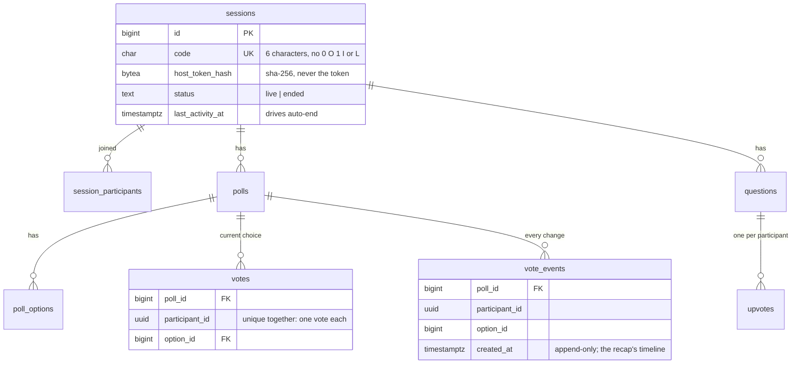

# Ralliyy

Live polls and Q&A for a room full of people. A host opens a session, everyone
else joins anonymously by a six-character code or a QR code, and results move on
every screen as the votes come in. Nobody makes an account.

**Live:** https://ralliyy.onrender.com · **A real session's recap:** see [A real session](#a-real-session)

[](https://github.com/cawfeemug/ralliyy/actions/workflows/ci.yml)

| Host dashboard | Participant, on a phone |
| --- | --- |
|  |  |

| Present mode, for a projector | The permanent recap |
| --- | --- |
|  |  |

## What it does

- **Join with nothing.** A code, or the QR code on the projector. No sign-up, no
  app, no email. A participant is a random id in the browser's local storage.
- **One poll at a time.** The host opens a poll, everyone votes, and the bars
  move on every screen within a quarter of a second. Voters can change their
  mind until the poll closes; the counts follow.
- **Questions, with a queue the host controls.** Anyone can ask, anyone can
  upvote, and the host can hide anything that should not be on the projector.
- **Present mode.** The same session at projector size: join code, QR code, the
  live poll and the top questions, nothing else.
- **A recap that outlives the session.** Every ended session keeps a public page
  at `/r/CODE` forever: how many of the people in the room took part, an activity
  chart over the session, each poll's final result, who changed their mind, and
  the questions that got the most votes.

## How it works

One Node process serves everything: the static pages, the REST API, and the
Socket.IO connection. There is no build step and no frontend framework — the
pages are plain HTML that load ES modules from `public/js/`.



**Every action is a REST call. Socket.IO only pushes.** A vote is
`PUT /api/polls/:id/vote`; the route writes it, and only then tells the realtime
layer to broadcast. The browser applies its own change from the HTTP response
and does not wait for the broadcast, so a participant with a flaky socket still
sees their own vote land. Sockets are never trusted to carry a write.

Here is one vote, end to end:



The 250 ms throttle is what makes a room of thirty people cheap: thirty votes in
two seconds produce eight broadcasts, not thirty, and each broadcast reads the
counts when it fires rather than carrying a count that was already out of date
when it was queued.

### Data model

Eight tables plus a migration ledger, in one migration file, no ORM. Counts are
never stored — they are always `COUNT(*)` over `votes`, so a displayed total
cannot drift away from the votes behind it.



A few constraints carry real weight:

- `CREATE UNIQUE INDEX polls_one_open_per_session ON polls (session_id) WHERE status = 'open'` —
  a partial unique index makes "one poll open at a time" a rule the database
  enforces, not a check the application hopes it remembered.
- `votes` is unique on `(poll_id, participant_id)`, so changing a vote is an
  `ON CONFLICT … DO UPDATE` in one statement — there is never an instant with
  zero votes or two.
- Everything cascades from `sessions`, so deleting a session really deletes it.

### Who is allowed to do what

- **The host** holds a 32-byte token, handed out once in the host URL. Only its
  SHA-256 hash is stored, compared with `timingSafeEqual`. A leaked database does
  not hand out host links.
- **A participant** is a UUID the browser generates and keeps in local storage,
  sent as `X-Participant-Id`. It is an identity for "one vote each", not a
  security boundary — it stops accidents, not a determined person with a console.
  Nothing a participant can do is worth more than a vote.
- **The recap** is public and read-only, and never includes hidden questions or
  anything derived from the host token.

## Decisions, and what they cost

| Decision | Why | What it costs |
| --- | --- | --- |
| REST for writes, Socket.IO only for broadcasts | One code path for every write, with the same validation and error handling. A dropped socket degrades the room's liveness, never the writer's own action. | A vote costs an HTTP round trip and a broadcast rather than one socket frame. |
| Rooms held in memory, no Redis adapter | A second moving part to run, pay for and monitor, for an app whose whole audience fits in one room. | **Exactly one instance may run.** Scaling out silently breaks broadcasts, so the limit is written here, in `src/realtime.js`, and in the deploy notes. |
| Plain SQL and `pg`, no ORM | The interesting parts of this app are the queries — a partial unique index, `FOR SHARE` on the poll row while voting against `FOR UPDATE` while closing it, the recap's three aggregates. An ORM would hide exactly the parts worth showing. | More SQL to read, and migrations are written by hand. |
| Vanilla ES modules, no framework and no build step | What you deploy is what you wrote. `docker compose up` is the whole toolchain, and the pages stay small on a phone. | DOM building by hand (`el()` in `public/js/ui.js`), and no component ecosystem to borrow from. |
| `vote_events` as an append-only log next to `votes` | `votes` answers "what is the result"; `vote_events` answers "how did the room get there" — the recap's timeline and the "3 of 14 changed their mind" line both come from it. | A second write per vote, and a table that grows with actions rather than voters. |
| The chart is inline SVG, hand-drawn | One chart, about forty lines, against a charting library on a page a phone loads once over mobile data. | No tooltips, no zoom; a second chart type would mean writing it again. |
| `/livez` separate from `/healthz` | Render pings liveness every few seconds. If that touched the database, Neon would never scale to zero and the free compute budget would be gone in about two weeks. | Liveness can pass while the database is unreachable, so `/healthz` is the one to check when something looks wrong. |
| Idle sessions auto-end after 24 hours, swept hourly | A host who closes their laptop should not leave a session live forever. `ended_at` is set to the last activity, not to the sweep, so the recap's duration stays honest. | Up to an hour between the rule being true and it being applied. |
| Rate limits keyed on the participant id, with an IP ceiling | A lecture hall is one NAT address. A per-IP vote limit would throttle the room; a per-participant limit throttles a person. | The participant id is client-controlled, so the fine-grained limits are a courtesy. The per-IP ceiling is the real defence. |

## Run it locally

Needs [Docker Desktop](https://www.docker.com/products/docker-desktop/) running.

```sh
docker compose up --build
```

Open http://localhost:3000. `/healthz` should return `{"status":"ok","db":"ok"}`.
Migrations run themselves at startup.

Stop with `Ctrl+C` or `docker compose down`. Data lives in the `pgdata` volume;
`docker compose down -v` wipes it.

To try it from a phone on the same Wi-Fi, give the app the address your phone
can reach, so join links and the QR code point somewhere useful:

```sh
BASE_URL=http://192.168.1.23:3000 docker compose up
```

## Run the tests

79 tests, all against a real PostgreSQL — no database is mocked.

```sh
docker compose up -d db   # just the database
cp .env.example .env
npm install
npm test
```

CI runs the same suite on every push and pull request, plus a Docker build, in
[`.github/workflows/ci.yml`](.github/workflows/ci.yml).

## Deployment

One Render web service (Docker, Singapore) and one Neon Postgres 16 database
(AWS Singapore), chosen so the server sits next to the people using it.

| Variable | Value |
| --- | --- |
| `DATABASE_URL` | Neon's **direct** connection string, with `?sslmode=verify-full`. Not the `-pooler` one: migrations take a session-level advisory lock, which PgBouncer's transaction mode does not support. |
| `BASE_URL` | The public URL, no trailing slash. Join links and QR codes are built from it. |
| `PORT` | Leave unset. Render injects it. |

Health check path: `/livez`. Instance count: **one** — see the decisions table.

## Backups

The repository can be rebuilt from git; the sessions people were promised a
permanent link to cannot. [`.github/workflows/backup.yml`](.github/workflows/backup.yml)
takes a `pg_dump` every Sunday night, encrypts it with AES-256, and keeps it as a
workflow artifact for 90 days — off the database host, so losing the database
does not lose the backup. It fails loudly if the dump comes back too small to be
real.

Two repository secrets make it work: `DATABASE_URL` (the same Neon string) and
`BACKUP_PASSPHRASE`. Run it by hand any time from the Actions tab.

To restore, download the artifact and:

```sh
gpg --decrypt ralliyy.sql.gpg > ralliyy.sql
psql "$DATABASE_URL" -f ralliyy.sql
```

## A real session

<!-- After running a session with real people, paste its /r/CODE link here. -->
_Coming: the recap of a real session, run with real people._

## Project layout

```
src/
  app.js          Express app, assembled without starting a server, so tests can mount it
  server.js       The process: pool, migrations, HTTP server, Socket.IO, shutdown
  security.js     Content Security Policy derived from what the pages load; rate limits
  auth.js         Session codes, host tokens, constant-time comparison
  db.js           The pg pool
  migrate.js      Runs migrations/*.sql under an advisory lock, each in a transaction
  validate.js     Input limits and parsing, in one place
  polls.js        Poll and vote queries shared by routes and broadcasts
  questions.js    Question and upvote queries
  lifecycle.js    Ending a session, by hand or by the idle rule
  recap.js        The recap's aggregates, and the maths, as pure functions
  realtime.js     Socket.IO rooms and the throttled broadcasts
  routes/         sessions, polls, questions, recap
  jobs/autoEnd.js The hourly sweep for idle sessions
public/           The five pages and their ES modules; no build step
migrations/       Plain SQL, applied in filename order
test/             79 tests against a real PostgreSQL
```

## Limits

A session holds up to 50 participants and polls are single-choice with 2–6
options, both in `src/validate.js`; one instance serves everyone, for the reason
in the decisions table. These bounds are what let the design stay this small, and
they are written down rather than discovered.

## Stack

Node.js 22, Express 5, Socket.IO 4, PostgreSQL 16 through `pg`, `qrcode` for the
join codes, helmet and express-rate-limit at the edge. Docker Compose for local
development, GitHub Actions for CI and backups.

The browser installs nothing: the only script on a page that we did not write is
the Socket.IO client, which the server itself serves from
`/socket.io/socket.io.esm.min.js`.
