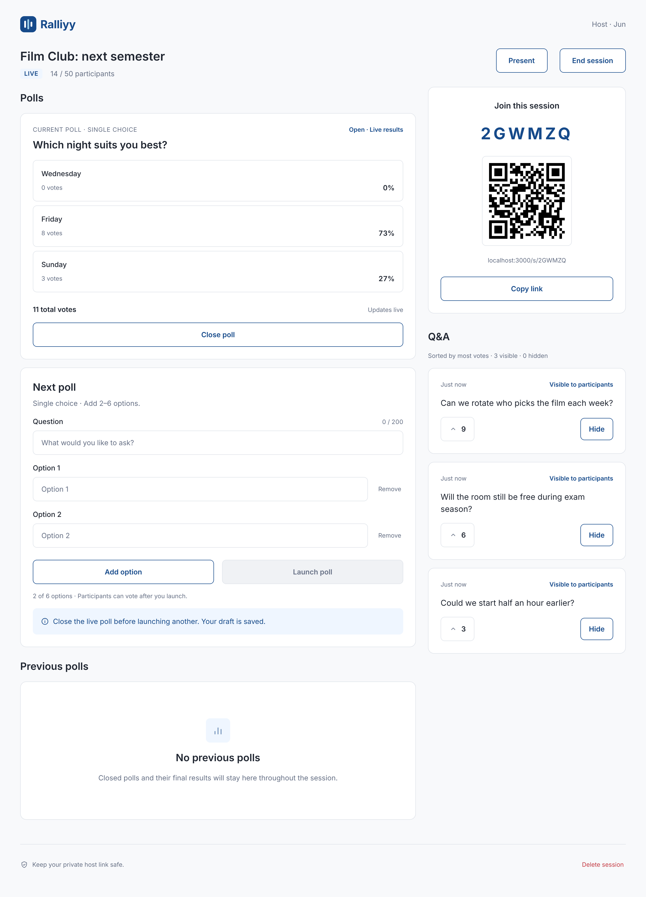
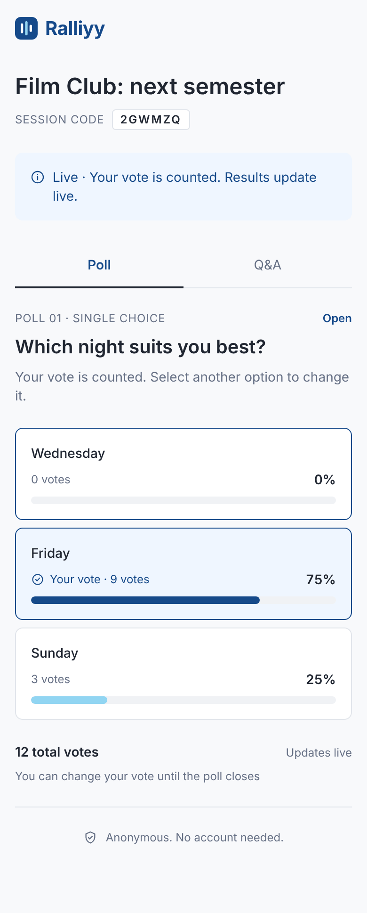
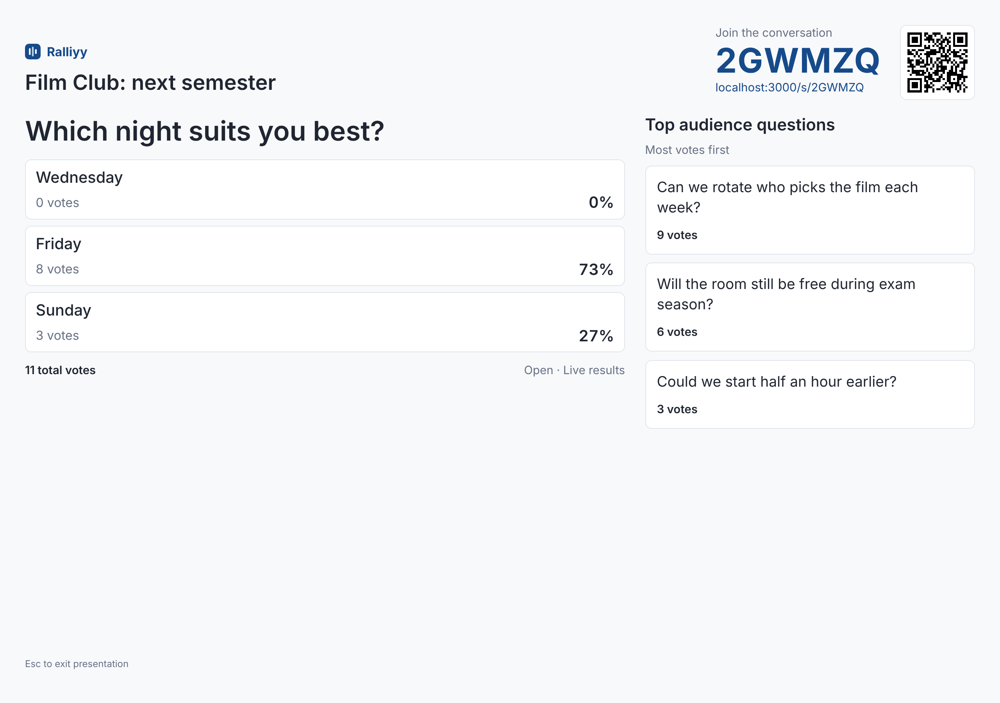
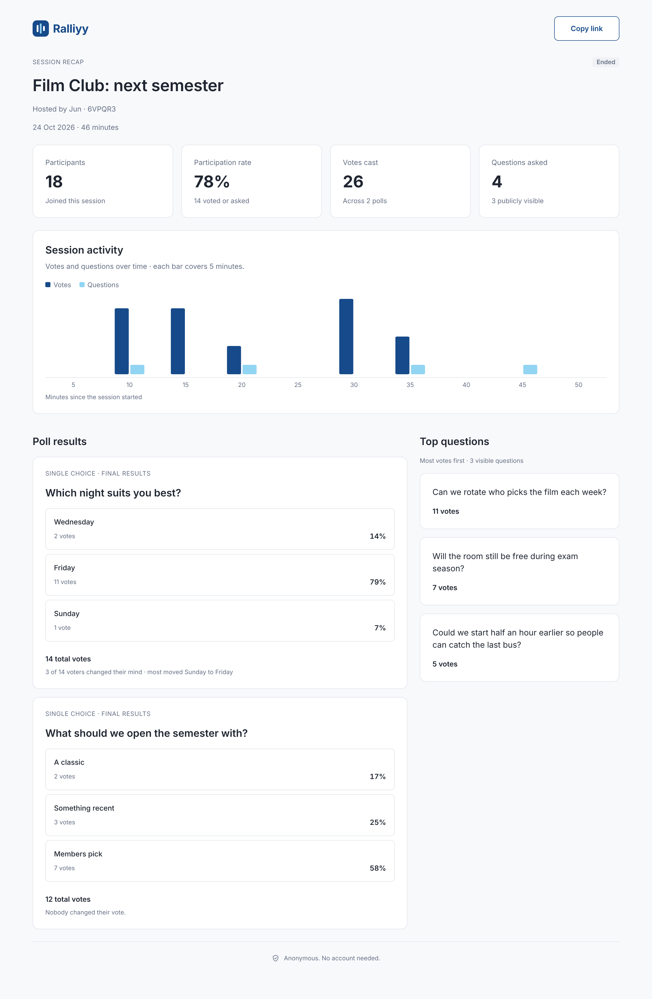

# Ralliyy

Live polls and Q&A for a room full of people. The host starts a session,
everyone else joins by a six character code or a QR code, and the results
update on every screen as people vote. No accounts, nothing to install.

Live at **https://ralliyy.onrender.com**

## Screenshots

Example sessions, to show what each page looks like.

| Host dashboard | Participant, on a phone |
| --- | --- |
|  |  |

| Present mode, for a projector | Session recap |
| --- | --- |
|  |  |

## What it does

- **Joining is just a code.** Six characters, or scan the QR code on the
  projector. No sign up, no email, no app.
- **Live polls.** The host opens one poll at a time and everyone votes. The
  bars move on every screen straight away. You can change your mind until the
  host closes the poll.
- **Questions with upvotes.** Anyone can ask a question, anyone can upvote one,
  and the most popular ones rise to the top. The host can hide anything that
  shouldn't be on the screen.
- **Present mode.** A clean full screen view for a projector: the join code,
  the QR code, the current poll and the top questions.
- **A recap that stays up.** When a session ends it keeps a public page at
  `/r/CODE`. It shows how many people took part, a chart of activity over the
  session, the final poll results, how many people changed their vote, and the
  questions that got the most upvotes.

## How it works

### Built with

- **Plain HTML, CSS and JavaScript** for the pages.
- **Node.js and Express** for the server.
- **Socket.IO** for the live updates.
- **PostgreSQL** for storing everything, using plain SQL rather than an ORM.
- **Docker and Docker Compose** to run it.
- **GitHub Actions** to run the tests and take a weekly database backup.

### Hosted on

- **Render** (Singapore) runs the app in a Docker container.
- **Neon** (Singapore) hosts the PostgreSQL database.

Both are in Singapore so the server is close to the people using it.

### Putting it together

It's one Node app that does everything: it serves the pages, answers the API
requests, and holds the live connections. One thing to build, one thing to
deploy.

The pages are just HTML and JavaScript running in the browser. There's no
framework, so what you see in `public/` is exactly what gets sent to the phone.

When someone votes, their browser sends an ordinary request to the server. The
server saves the vote to the database first, and only then tells Socket.IO to
push the new totals out to everyone else watching that session. So the database
is always the thing that's actually true, and the live updates are there to
save people from refreshing. If someone's connection drops, their page just
asks the server for everything again when it reconnects.

Socket.IO keeps each session in its own room, named after the session code, so
an update only reaches the people in that session and nobody else.

Everything is stored in PostgreSQL, so nothing is lost if the server restarts.
That's also why a session's recap page still works months later. The database
is backed up once a week by a GitHub Action, which takes an encrypted copy and
keeps it away from the database itself.

## Run it yourself

You need [Docker Desktop](https://www.docker.com/products/docker-desktop/)
running. That's it, everything else is in the container.

```sh
docker compose up --build
```

Then open http://localhost:3000. The database tables are created automatically
the first time it starts.

Stop it with `Ctrl+C`, or `docker compose down`. Your data stays in a Docker
volume between runs, and `docker compose down -v` clears it.

To try it from your phone on the same Wi-Fi, tell the app the address your
phone can reach, so the join link and QR code point somewhere useful:

```sh
BASE_URL=http://192.168.1.23:3000 docker compose up
```

### Running the tests

There are 79 tests and they run against a real PostgreSQL, not a fake one. You
need Node.js 22 and the database container.

```sh
docker compose up -d db
cp .env.example .env
npm install
npm test
```

They also run automatically on GitHub for every push and pull request.

## Project layout

```
src/
  app.js          Sets up Express and all the routes
  server.js       Starts everything: database, migrations, web server, Socket.IO
  security.js     Security headers and rate limiting
  auth.js         Session codes and host tokens
  db.js           The database connection
  migrate.js      Runs the SQL files in migrations/ when the app starts
  validate.js     Checks user input, all in one place
  polls.js        Poll and vote queries
  questions.js    Question and upvote queries
  lifecycle.js    Ending a session
  recap.js        The numbers behind the recap page
  realtime.js     Socket.IO rooms and live updates
  routes/         The API: sessions, polls, questions, recap
  jobs/           Automatically ends sessions left running

public/           The pages, their CSS and their JavaScript
migrations/       The database schema, as plain SQL
test/             The tests
```
